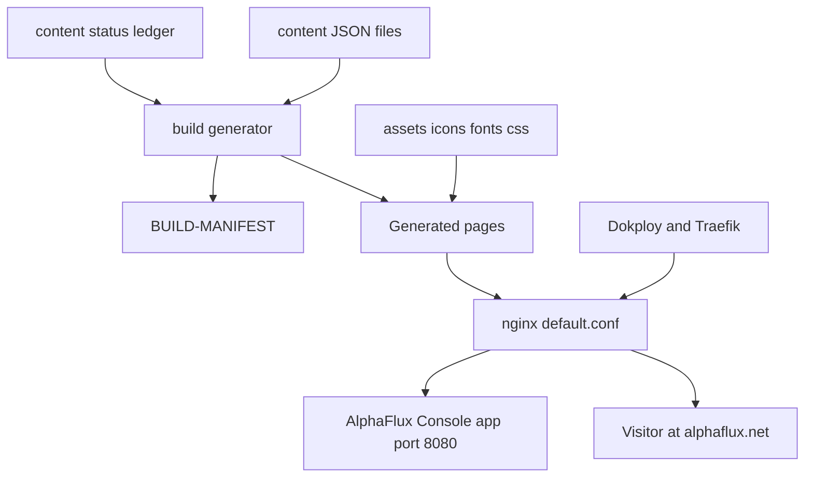

<!--
INSTRUCTIONS FOR THIS FILE (user and AI: read before editing. Keep this header.)

WHAT THIS FILE IS: the whole project laid out, at docs/MAP.md: every
module, page, screen, engine, and service, and every link between them
traced BOTH ways (what it points to, and what points back at it). It
exists so anyone can see the entire system at once and think about it
whole. A rendered visual version is generated from this file.

EXACT STRUCTURE:
- "## The grid": a table of every node: name, kind (page, screen,
  module, engine, service, external), what it owns.
- "## Links": a table of every connection: from, to, kind (navigates,
  calls, reads, writes, emits, hosts), and the backlink (the reverse
  relationship, named, or "none").
- "## Diagram": a Mermaid flowchart of the same nodes and links, kept
  in sync with the tables above it.
- "## Flows": the two or three main journeys through the system, in
  words, step by step.

RULES:
- Every node in the tables appears in the diagram and vice versa.
- When a module or link is added or removed, this file changes in the
  same commit.
- Facts only: the map shows what exists, with planned nodes marked
  (planned) so vision and reality never blur.
- No secrets, passwords, or tokens in this file, ever.
-->
# MAP: AlphaFlux Web (alphaflux.net)

## The grid
| Node | Kind | Owns |
| :--- | :--- | :--- |
| content/*.json | module | One file per page; the source of truth for all copy |
| content/_status.json | module | Build status per page, section, and feature; feeds BUILD-MANIFEST.md |
| build/ generator | module | The Go generator, standard library only; writes pages, sitemap.xml, robots.txt, llms.txt, llms-full.txt, BUILD-MANIFEST.md |
| BUILD-MANIFEST.md | page | The generated spec-against-reality ledger: 5 LIVE, 10 PARTIAL, 4 PLANNED, 5 N/A |
| assets/site.css | module | The token layer and every component style |
| assets/fonts.css and assets/fonts/ | module | Self-hosted faces, Latin and Latin Extended subsets |
| assets/icons.svg | module | The icon sprite; every icon referenced by id from content |
| assets/og/ | module | Open Graph card sources, rendered to PNG by scripts/make-og.sh |
| Overview page / | page | The home page (PARTIAL) |
| Platform page /platform | page | How it works (LIVE) |
| AI agents page /ai-agents | page | AI agents (PARTIAL) |
| Modules page /modules | page | All modules (N/A) |
| Security page /security | page | Security (PARTIAL) |
| White-label page /white-label | page | White label (PLANNED) |
| Calls and messaging page /calls-and-messaging | page | Phone and messaging (LIVE) |
| Field operations page /field-operations | page | Field operations (PARTIAL) |
| Fleet page /fleet | page | Fleet and dispatch (PLANNED) |
| Scheduling page /scheduling | page | Scheduling and agreements (PARTIAL) |
| CRM page /crm | page | CRM and sales (LIVE) |
| Inventory page /inventory | page | Inventory and assets (PARTIAL) |
| Billing page /billing | page | Billing and payments (PARTIAL) |
| Email marketing page /email-marketing | page | Email marketing (PARTIAL) |
| Marketing page /marketing | page | Marketing and growth (PARTIAL) |
| Team page /team | page | Team and collaboration (LIVE) |
| Analytics page /analytics | page | Reports and analytics (LIVE) |
| Pricing page /pricing | page | Pricing (N/A) |
| Industries page /industries | page | Industries (N/A) |
| Programs page /programs | page | Community programs (N/A) |
| Developers page /developers | page | Developers (PARTIAL) |
| Sitemap page /sitemap | page | Site map (N/A) |
| Privacy page /privacy | page | Privacy (PLANNED in the status ledger) |
| Terms page /terms | page | Terms (PLANNED in the status ledger) |
| default.conf (nginx) | service | Clean URLs via try_files, cache policy, admin path passthrough, and the console proxy paths |
| Dockerfile | service | The container: plain static files, no Go toolchain at build time |
| Dokploy and Traefik | service | Hosting on ubuntu-server; the Traefik dynamic file routes alphaflux.net to this service |
| AlphaFlux Console app | external | The platform app on port 8080 behind the front door (repo alphaflux-console) |
| Visitor | external | The public reader of alphaflux.net |

## Links
| From | To | Kind | Backlink |
| :--- | :--- | :--- | :--- |
| content/*.json | build/ generator | reads | build/ generator renders content/*.json into pages |
| content/_status.json | BUILD-MANIFEST.md | writes (through the generator) | BUILD-MANIFEST.md reports the statuses content/_status.json declares |
| build/ generator | Every page node | writes | Every page is generated output of build/; pages are never edited by hand |
| build/ generator | BUILD-MANIFEST.md | writes | BUILD-MANIFEST.md is regenerated on every build |
| assets/icons.svg | content/*.json | reads (icons referenced by id) | content/*.json names the icons assets/icons.svg must contain; the build fails on a missing icon |
| assets/site.css | Every page node | hosts (styles) | Pages link the stylesheet the build versions by content hash |
| Every page node | Visitor | navigates (rail, footer, and page links) | Visitor arrives from search, the rail, and the footer |
| default.conf (nginx) | AlphaFlux Console app | hosts (proxies /login, /console, /api, /phone, /twilio, /scan, /patrol, /admin, /waitlist, /accept to port 8080) | AlphaFlux Console app is reached publicly only through this front door |
| Dokploy and Traefik | default.conf (nginx) | hosts | The container reports through Dokploy deployment state |
| Dockerfile | default.conf (nginx) | hosts | default.conf ships inside the image the Dockerfile builds |
| Privacy page /privacy | AlphaFlux Console app | reads (must reconcile with the console Terms of Service when it publishes) | The console Terms of Service is the document the privacy and terms pages reconcile against (TODO T-3.5) |
| Terms page /terms | AlphaFlux Console app | reads (same reconciliation) | Same backlink as the privacy page |

## Diagram

## Flows
1. A page is born: a content JSON file is added, registered in the Site groups in build/main.go, go run ./build renders it into the rail, footer, sitemap, and llms files, and its status enters the ledger in content/_status.json.
2. A visitor arrives: Traefik routes alphaflux.net to this swarm service, nginx serves the static page, and the page copy points at the platform the console repo runs.
3. The front door: a visitor follows /login (or any console path) and nginx proxies the request to the AlphaFlux Console app on port 8080 without leaving the domain.
4. A claim becomes true: a console feature ships, its status flips in content/_status.json, the build regenerates BUILD-MANIFEST.md and the pages, and OG cards are regenerated with the copy change.
